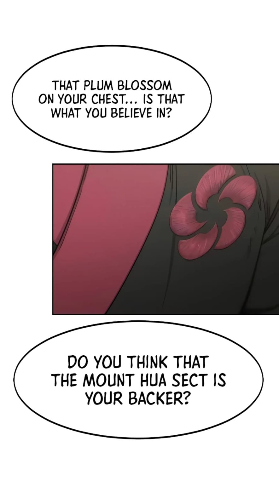
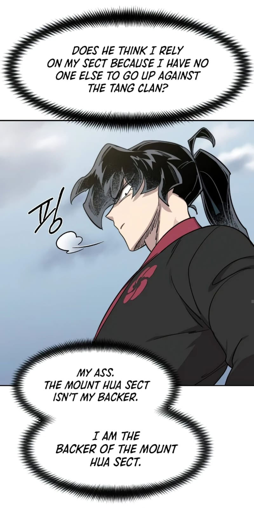
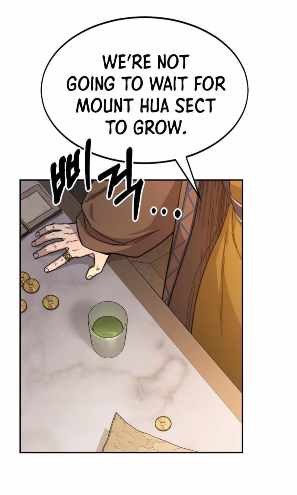
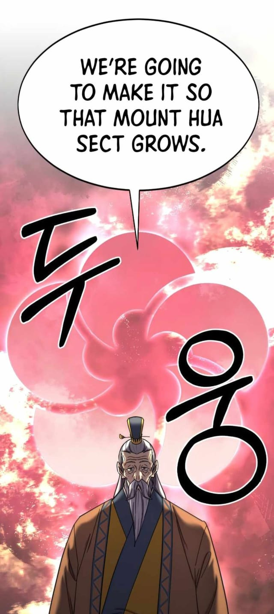
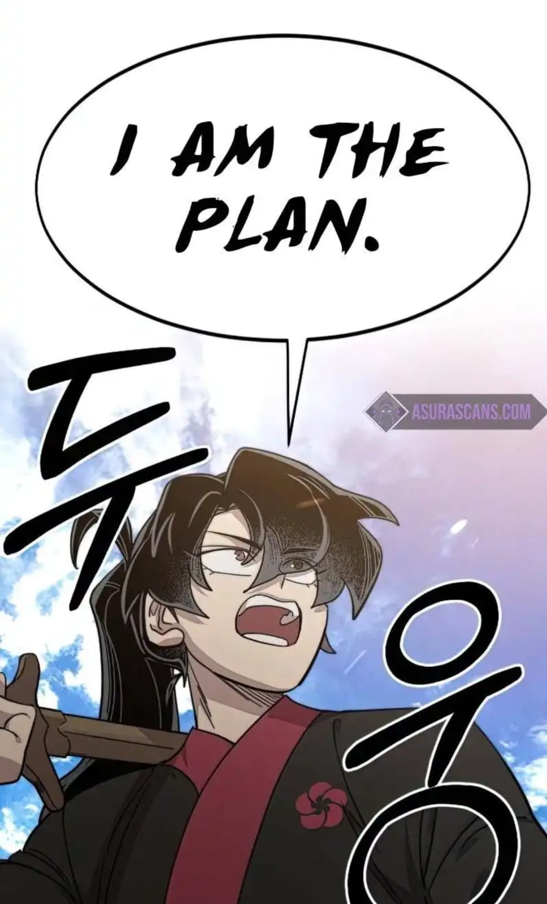
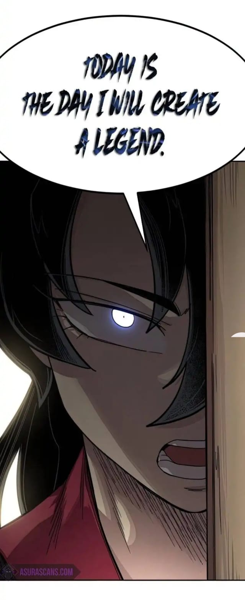

It's weird how we humans are wired. We constantly find ourselves thinking about what our lives could have been if we had made certain choices at certain times. Our minds wander, reliving hundreds of different realities that could have spawned from that one decision we regret. Funnily enough, some of those decisions were never even ours to begin with, yet we keep carrying regrets for the outcomes.

It's rightly said that expectations are the root of suffering. We do things in life expecting something, or someone. For some, it's praise; for some, a sense of belonging; for some, money; for some, love. And when we don't get it, it breaks something within us. We end up placing these expectations at the center stage of our lives. Sometimes we do need anchors to help us withstand the waves of difficulty that life throws at us, but it's on us to bear the weight of those waves—not the anchor.

Then how do you even think of moving forward after constant failure—when your past feels like a pitiful graveyard of mistakes? The only way forward is realizing that you are on your own. No one truly knows what you are going through, and no one is coming to save you. The thoughts we cling to—that someone will step in and rescue us—are just comforting stories to soothe our minds. Your pain is yours to bear alone, in silence, hidden from the world.

Once that realization hits, everything else falls away: you are now your own backer.

Perhaps, somewhere along the way, we realize that we have to become our own source of strength. Not because we don't need anyone, but because we cannot put our lives on hold waiting for someone else to help us move forward.

We spend so much of our lives waiting for something or someone to save us. Perhaps the real turning point comes when we stop waiting and start taking responsibility for our own lives.

The past won't change. The choices we made, the opportunities we missed, the things we lost, and the outcomes we regret are all beyond our reach now.

But what we do next is still ours to decide.

